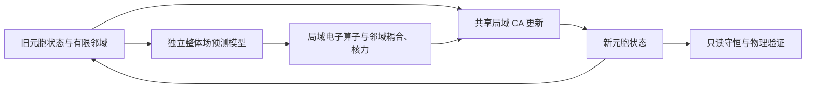
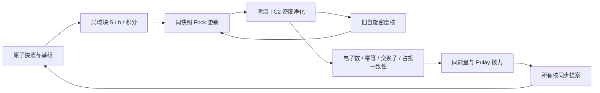

# v0.5 局域 CA 与独立整体场

本体的计算规则只读取固定容量的元胞状态、有限接触邻域和本轮场预测。电子约束不通过全体系 SCF、全局 C/P/S 或全局占据投影实施。整体场预测与 CA 更新是独立阶段；HF 电子求解器保留为小体系参照，不能用其积分成本代表 CA 的规模成本。

## 当前可运行的本体

- `CellSnapshot`：核状态、持续 ID、每元胞固定大小的局部自旋约化密度与有效通道数。
- `FieldSnapshot`：每元胞有效 Hamiltonian、每条接触边的电子耦合，以及整体场给出的核力。它是本轮旧快照的外部输入，不在执行器内部计算整体场。电子场可直接预测这些有效算子，也可经过局部投影得到；能量是场模型的额外观测，后续应检验核力与同一能量的关系。
- `LocalCellEngine`：两个 onsite 半步与一个并行两元胞通道阶段；核 kick/drift 读取同一个旧场快照。所有边都读取旧电子状态，分批只影响内存，不改变更新顺序的物理意义。
- `save_cells` / `load_cells`：独立的局域 CA 状态格式，保存完整局部密度、核状态和时钟，CPU/GPU 可恢复。

两元胞阶段用局部的 `2d × 2d` Hermitian 算子生成 unitary，作用于 `diag(ρᵢ,ρⱼ)`，提取两端约化密度。边权重取 `wᵢⱼ = 1/max(degᵢ,degⱼ)`，每个元胞更新为旧态与各邻域提案的凸混合。

因为每条边在两端采用相同权重，pair trace 的变化相互抵消，各自旋总电子数保持不变。每个元胞的权重和不超过 1；unitary、取主块与凸混合都保持 `0 ≤ ρᵢ ≤ I`。这些约束由局域更新规则满足；全局总和只用于只读验收，不反馈电子数修正。

这是一种显式的约化态/均场闭合。它不保存完整跨元胞相干或多电子纠缠，不能直接当作 HF 等价算法或正确分子化学已成立。整体场模型、局部闭合和 latent dynamics 的物理作用都仍需后续数据与实验验证。

## 复杂度与验收边界

通道上限 `d`、邻域上限 `K` 与更新阶段数固定时，本体工作量约为 `O(N K d³)`，每元胞工作量与 N 无关。足够并行资源下每轮延迟可以不随 N 增长；同一块硬件上的总耗时受吞吐、访存和调度限制。邻域构建、整体场预测、本体更新与诊断分别测量。当前还没有分布式多 GPU 实现。

验收包括二元胞解析输运、重叠邻域电子数/Pauli 界、一步一跳传播、分批不变性、训练梯度、自由核更新、重启与原子重排。大型输入使用未训练数值场，不进行化学反应判定。

## v0.4 独立 HF 参照

原子元胞包含核状态和原子中心的局域 AO 通道。电子占据以两个原子块密度核 P↑/P↓ 保存，电子云形状来自轨道混合，不再由一个网络云宽度替代电子结构。格点场工具是独立组件，原子不受“每格一个原子”限制。

## 数据与责任

| 模块 | 责任 |
|---|---|
| `molecule.py` | 不可变原子快照、连续核坐标、持续 ID、电荷/自旋约束、物理密度核 |
| `quantum/blocks.py` | 原子块代数、预算、Gershgorin 界、带实际误差界的压缩 |
| `quantum/purification.py` | 自适应逆平方根与零温投影；不需要全局占据轨道 C |
| `quantum/operators.py` | 一致的 HF 能量/Fock 闭合，和电子求解器分离 |
| `quantum/gaussian.py` | 真实原子块积分及导数；有界四中心积分缓存 |
| `runtime/scf.py` | 共享旧电子快照的 Fock 更新、TC2、DIIS 与收敛判定 |
| `quantum/evaluator.py` | 对同一核快照得到自洽能量与解析力 |
| `runtime/molecular.py` | 全部原子同步 kick/drift/kick，成功后一次提交 |
| `quantum/observables.py` / `analysis/` | 只读布居、键指标和轨迹统计，不反馈反应标签 |

## 度量和占据

非正交 AO 需要度量变换 T。用原子块 Newton–Schulz 迭代获得 T，直接检查 `Tᵀ S T ≈ I`，不靠固定阶数或任意对角 jitter 掩盖误差。

将真实 Fock 算子变换为 `Tᵀ F T`，由保守谱界初始化 X，再使用 TC2：电子数偏多时 `X ← X²`，偏少时 `X ← 2X−X²`。以实际数目与幂等残差停止，得到 `Pσ = T Xσ Tᵀ`。

该方法来自[零温密度矩阵净化](https://arxiv.org/abs/cond-mat/0209502)。它取代了固定 sigmoid 区间和 ±8 辅助坐标，不存在人为的约 2% 激发态占据底噪。部分占据的未解简并或过小间隙导致明确失败，有限温度需要独立的温度/熵定义。

压缩是明确的数值操作：保留对角块，报告丢弃矩阵的全局行范数界，并检查最终幂等性、电子数与交换子。报告的逐步丢弃界之和是实际筛选记录，不被冒充为完整非线性误差传播证明。任何算子的乘法容量或临时内存超限都直接失败。

## 自洽与核力

HF 物理层使用动能、点核吸引、核间排斥、Hartree 与精确交换。自洽迭代每次由同一个 P 快照建立所有 Fσ，DIIS 只求解固定历史大小的标量 Gram 系统，没有系统级量子对角化。

核力由同一变分能量的积分导数得到。基组运动的 Pulay 项使用能量加权密度 `Wσ = Pσ Fσ Pσ`，不需要全局 C。同步执行器只接受通过电子收敛检查的提案，输入快照不被修改。

长程库仑是物理 Hamiltonian 的组成部分。局域块表示不意味着所有耦合都能成为严格最近邻。精确高斯供应器目前按原子四中心块求积分、有缓存和预算；线性标度积分、周期边界和分布式通信属于下一层工作，不能从矩阵压缩例子直接推断已经完成。
